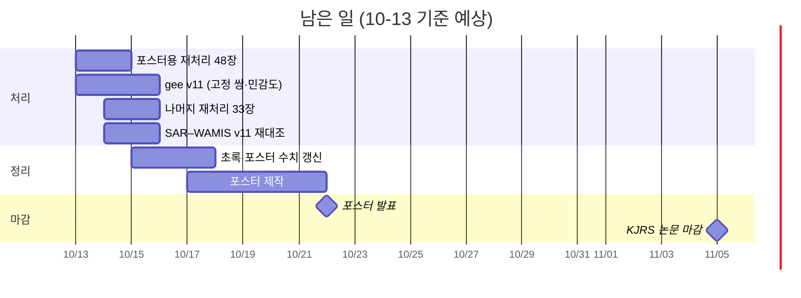

# 2026 여름 가뭄 Sentinel-1 프로젝트 — 전체 리뷰 (2026-10-05 ~ 10-13)

> 기준 시각 2026-10-13 13:00. 같은 내용의 HTML 판: [PROJECT_REVIEW_20261013_KR.html](PROJECT_REVIEW_20261013_KR.html).
> 근거 문서: [ISSUES #26](ISSUES_KR.md) · [REVIEW_20261005_KR.md](../drought/REVIEW_20261005_KR.md) · [TODO_KR.md](TODO_KR.md) ·
> gee `docs/HANDOFF_FROM_S1_20261005_KR.md` §2-7·§2-8.

## 요약

8월 10일 이후 만든 Sentinel-1 RTC 전부가 위성 쪽으로 30~50 m 밀려 있었다. 원인은 외부 DEM(COP30)을 쓸 때
EGM 보정을 끈 설정이다. 시험 처리에서 세 판정을 모두 통과해 원인을 확정했고, 10-12 21:32부터 EGM을 켠
83장 재처리를 진행 중이다.

- 포스터 설계는 확정됐다. 같은 위성 1:1 쌍(v11)을 본문에 두고, 그 옆에 8월 하강궤도 S1C↔S1C 민감도 4쌍을
  쌍별로 나란히 싣는다.
- 포스터 수치는 아직 하나도 확정되지 않았다. 확정본은 gee가 EGM 판 영상으로 계산하는 v11이다.
- 초록의 7월 수치(8개 유역 −0.6~−18.5%)는 바뀐다. 5곳의 비교 쌍이 바뀌고, 위치 보정 효과도 더해진다.

## 목표와 일정

2026년 7·8월 남부 가뭄을 Sentinel-1/2로 분석해 전년도(2025)와 비교한다. 연구 질문은 "해마다 오는 여름
폭우(2025) 대 이례적인 여름 가뭄(2026)"이다.

| 항목 | 날짜 | 비고 |
| --- | --- | --- |
| 추계 원격탐사학회 포스터 | 2026-10-22 | 본문 = v11 고정 쌍 + 8월 민감도 4쌍 |
| KJRS 논문 마감 | 2026-11-05 | 같은 v11 수치를 쓴다 |

## 진행 경과

10-12 오후가 전환점이다. v10 저수지 값을 대조하다가 EGM 위치 오류를 찾았고, 그때부터 재처리와 v11로
방향을 바꿨다.

| 날짜 | 한 일 |
| --- | --- |
| 10-13 | 판정 ②(호소 폴리곤 이동 시험)를 S1이 직접 재 통과. 틀린 EGM 안내 4곳 정정. 8월 A·B군, 7월 A군 모자이크를 EGM 판으로 교체. gee-4c가 v11 착수(메모리 창을 위해 L1 레인 정지). 촬영 모니터링 예약 중지 |
| 10-12 저녁 | EGM 시험 2장 판정 ① 통과(상승↔하강 −8 → −1화소). 21:32 EGM 켬 81장 재처리 시작. v10 2단계 35장 NAS 이동 |
| 10-12 오후 | v10 산출(v9와 유역 Δ% 차이 ≤ 0.7%p). SAR–WAMIS v10 16/16 하한 성립. 7월 저수지 차이를 추적하다 EGM 문제 발견 |
| 10-12 정오 | 포스터 설계 재결정: 여러 날 집계 없이 1:1 쌍 + 민감도 4쌍. 7월 쌍 일부 변경(하강 12개 유역, 접경 2행, 동부 4곳) |
| 10-12 오전 | WAMIS 담수호 21곳 수집 복구. 관측 29개 강우 주석. 하루 두 궤도 3건을 gee에서 날짜·궤도 단위로 수정. 죽은 모자이크 24개 정리 |
| 10-11 | 정밀궤도(POEORB) 재처리 83/83 완료, 모자이크 29개 재작성. rel 61은 진행하지 않기로 함 |
| 10-07 | 블루스크린(메모리 압박 때). 덤프 진단은 아직 안 함 |
| 10-06 | 2025 비교일 일부가 폭우 직후임을 강우로 확인. 용어를 "전년도"로 |
| 10-05 | 가뭄 리뷰: SAR 면적이 공식 저수량 감소를 덜 잡음, 2025는 평년이 아님, SWOT 수위 사용 가능. 정밀궤도 재처리 착수 |

## 현재 상태 (10-13 13:00)

EGM 재처리는 83장 중 24장(포스터용 48장 중 22장)을 끝냈고, 포스터용은 10-14 오전~낮, 전체는 10-15에 끝난다.

| 항목 | 상태 |
| --- | --- |
| EGM 재처리 | 24/83장, 실패 0. 장당 58~118분. 지금은 L2 레인 하나, L1은 gee 계산 동안 멈춤 |
| EGM 판 모자이크 | 6/29 — 8월 A군(0802↔0806), 8월 B군(0807↔0811), 7월 A군(0715↔0725) |
| gee v11 (gee-4c 담당) | 1단계 쌍 파일 `watershed_pairs_v11.json` 완료(궤도 키 6개). 2단계 8월 B군 진행 중 |
| 메모리 | 레인 2개면 여유 1.5~4 GB. gpt당 최대 13 GB로 제한, 큰 계산은 레인을 멈춘 "창"에서 |
| 디스크 | E: 여유 184 GB(재처리에 충분), F: 29 GB |
| 보관 | v10 2단계 RTC 35장은 NAS `X:\02_Analysis\Sentinel-1_Drought\v10_poeorb_egmoff_20261012\` 로 이동(크기 대조 후) |
| 깃 | S1 `91d687b`, 원격보다 26커밋 앞섬(푸시 전). gee `775d19d` |

## 확정된 결정

비교는 같은 위성·같은 상대궤도의 1:1 쌍으로만 하고, 여러 날을 평균이나 중앙값으로 묶지 않는다.

| 항목 | 결정 |
| --- | --- |
| 비교 대상 | 전년도(2025) ↔ 2026, 7·8월. 9월 제외 |
| 처리 규격 | VH · Frost · `korea_peninsula_cop30` · 정밀궤도 · **EGM 켬**(10-12 확정) |
| 쌍 기준 | 같은 위성 기본, rel 127은 같은 궤도면 됨(1C↔1D). 저수지를 가장 많이 덮는 촬영. 7·8월 따로 |
| 7월 쌍 | 상승54 0725↔0715(접경 포함) · 하강134 0718↔0720 |
| 8월 쌍 | A군 0806↔0802 · B군 0811↔0807(1C↔1D) · 한강 0812↔0802(1A↔1D, 커버 우선) |
| 포스터 본문 | v11 1:1 쌍 + 8월 하강134 S1C 민감도 4쌍(0811·0823 × 0813·0825, 안동·임하·옥정·평림) |
| 강우 | 걸러내는 기준이 아니라 해석용 주석(촬영 직전 5일 WAMIS 강우) |
| 제외 | rel 32(짝 없음) · rel 61 · 여러 날 집계 · 한강유역 밖 북한 9장 · 0707·0714·0712·0726·0731 쌍 |

## EGM 판정 결과

판정 기준은 결과보다 먼저 적었다(ISSUES #26). 시험 영상은 2026-07-14 상승 `376D` · 하강 `B126`(12시간 차, 강우 거의 0).

| 판정 | v10 (EGM 끔) | EGM 켬 | 결과 |
| --- | --- | --- | --- |
| ① 같은 날 상승↔하강 수체 마스크 어긋남 (담수호 9곳) | 중앙값 −8화소 | 중앙값 −1화소 | 통과 |
| 보조: v10 → EGM 판 이동 | — | 상승 +4 · 하강 −4화소 | 예측과 일치 |
| ② 호소 폴리곤 이동 시 면적 최대 지점 (8~9곳) | 상승 −4 · 하강 +6열 | 상승 −1 · 하강 +1열 | 통과 |

측정 도구: `python -m s1.tools.audit.geoloc_shift A B`, `python -m s1.tools.audit.polygon_shift A [B …]`(sar-gee 환경).

## 발견한 문제와 교훈

가장 큰 문제는 근거 없는 사양 한 줄("COP30은 이미 타원체고")이었다. 바다 화소 하나만 찍어 봤으면 8월에 끝났을 문제다.

| 문제 | 영향 | 조치 |
| --- | --- | --- |
| COP30 높이를 타원체고로 알고 EGM을 끔 (ISSUES #26) | 8-10 이후 RTC가 위성 쪽으로 30~50 m 밀림. 폴리곤으로 자른 면적 1.5~5.4% 과소 | EGM 켬 재처리. 예전 근거(NGII 대조)는 거꾸로 읽은 것이었다 |
| 하루 두 궤도인 날을 날짜로만 불러 관측 4개 누락 | 하강134 2025 관측이 4일에서 2일로 | gee가 날짜·궤도 단위로 수정, v11은 전 회차 `--force-o` |
| v8 쌍 고르기가 커버만 보고 위성이 다른 날을 고름 | 초록이 인용한 유역 수치가 "동일 위성" 문구와 다름 | 같은 위성 우선으로 변경 |
| 이전 보고서가 같은 유역에 2025 기준일을 둘 씀 | 유역 표 0707(폭우 전) · 저수지 표 0725(폭우 후) | 0725로 통일, 폭우 직후 기준일임을 주석 |
| gpt 둘 × 최대 22 GB | 10-07 블루스크린, 10-12 여유 170 MB까지 | gpt당 13 GB 제한, 큰 계산은 레인을 멈춘 창에서 |
| 짝을 이루는 표 둘 중 하나만 고침 (ISSUES #25) | gee 산출 중단 | 도구가 두 표를 함께 대조 |
| 인계에 적은 gee 명령이 그대로 안 돌았음 | `--only-obs` 미배선 | gee-4c가 고침(gee `5dc1500`) |

이번 작업 중 결론을 두 번 뒤집었다("v10이 맞다" → "v9 7월이 제자리"). 그 뒤로는 판정 기준을 결과보다 먼저 적고 진행했다.

## 수치 상태

포스터에 바로 인용할 수 있는 것은 강우 주석과 WAMIS 공식 저수량뿐이다. SAR 수치는 모두 v11을 기다린다.

| 수치 | 상태 |
| --- | --- |
| 강우 주석(관측 29개, `data/rain_phase_5d.csv`) · WAMIS 공식 저수량 · EGM 원인 | 확정 |
| v10 유역·저수지 값 | 쓰지 않음(EGM 끈 판, 비교용으로만 보관) |
| "SAR 면적 변화는 저수량 변화의 하한" | v10에서 16/16 성립(k_eff 1.62~21.2). v11로 다시 잰다. 차이가 커서 유지될 가능성이 크다 |
| 초록 "7월 8개 유역 모두 감소(−0.6~−18.5%)" | 바뀐다. 5곳의 쌍이 바뀌고(0707 4곳, 섬진강 0714) EGM 효과도 더해진다 |

2025 기준일을 폭우 직후(07-25)로 통일하면 동부 저수지의 2025 수위가 07-07보다 1.5~9.6 m 높아서,
7월 감소율이 커진다(예: 영천 −0.6% → −15% 안팎). 포스터에 이 점을 밝힌다.

## 남은 일과 일정

포스터용 48장이 10-14에 끝나면 gee가 v11과 민감도 4쌍을 내고, 10-15부터 수치를 갱신해 10-17부터 포스터를 만든다.
나머지 33장은 포스터와 무관하게 10-15에 끝난다.

## 결정이 필요한 사항과 위험

일정 여유는 충분하다(재처리가 10-15에 끝나도 포스터까지 약 1주). 정해야 할 것은 세 가지다.

- [ ] 폭우 전 날짜(07-07) 보조 수치를 포스터에 한 줄 넣을지. 위성이 달라(S1A) 본문 기준에서는 빠진다
- [ ] 포스터용 48장의 v10 판(E:, 약 120 GB)을 검증 후 NAS로 옮길지 지울지
- [ ] S1 저장소 푸시(26커밋)

위험:

- 메모리: 레인 2개와 gee의 큰 유역(한강 격자 22,095×29,981) 계산이 겹치면 블루스크린 위험. "창" 운영으로 갈라 돌린다
- 초록 수치 변화 폭: 같은 위성 기준과 폭우 후 기준일로 7월 감소율이 커진다. 해석 문구를 미리 맞춘다
- 세션 간 연락: gee 세션이 바뀌면 메시지가 안 닿는다. 인계는 gee `docs/HANDOFF_FROM_S1_20261005_KR.md` §2-8,
  모자이크 교체 목록은 S1 `temp/egm_vrt_done.txt`가 기준
